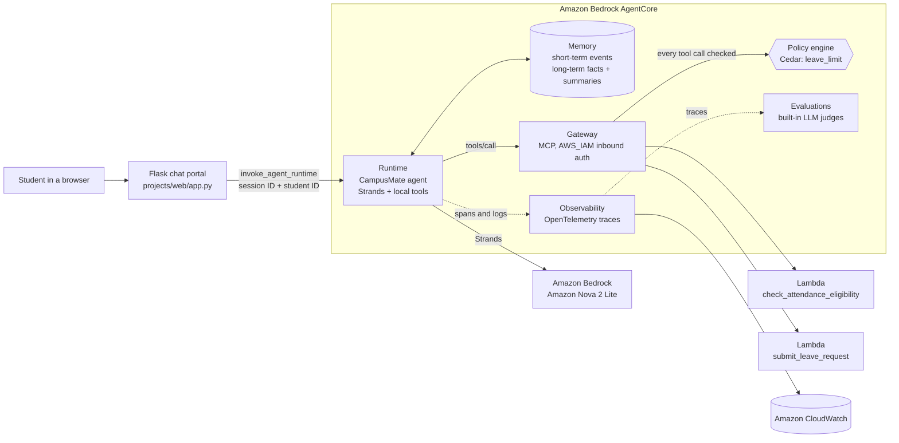

# Building Production-Ready AI Agents with Amazon Bedrock and AgentCore

> **Hands-on workshop for the AI-Driven DevOps (AIDD) program, School of Computer Science and Engineering, Jain (Deemed-to-be University), Bengaluru**

A two-day, hands-on workshop (9:00 AM - 3:30 PM each day) for 2nd and 3rd year B.Tech students.
You start with "what is a token?" and finish with a governed, observable, evaluated AI agent running on AWS that you built yourself.

The running project is **CampusMate**, an AI assistant for students of the School of CSE. It answers questions about courses and campus rules,
checks attendance and exam eligibility, files short leave requests, remembers each student, and refuses to break the rules even when someone tries to trick it.

> All student, course, policy and event data in this repository is **fictional** and labelled as such. Nothing here is a real university rule.

---

## What you will be able to do (learning objectives)

1. **Explain what an AI agent is**: an LLM (large language model) plus code that lets it call **tools**, with short-term and long-term **memory**.
2. **Build an agent locally** with Strands Agents and Amazon Bedrock, testing small pieces in Jupyter before running the whole thing.
3. **Deploy it to production** on Amazon Bedrock AgentCore Runtime (serverless microVMs, isolated sessions) and call it from a web app.
4. **Give it memory and shared tools**: AgentCore Memory for cross-session recall, AgentCore Gateway to turn AWS Lambda functions into MCP tools.
5. **See inside it and grade it**: traces, spans, token costs with AgentCore Observability, and LLM-as-a-judge scores with AgentCore Evaluations.
6. **Govern it**: understand prompt injection, and enforce rules outside the model with Cedar policies at the Gateway.

## Architecture



## Learning path

| Day | Time | Notebook | You build | CampusMate |
|---|---|---|---|---|
| 1 | 9:00 | [01 GenAI foundations](notebooks/01-genai-foundations.ipynb) | Hallucination and statelessness demos | v0 |
| 1 | 9:45 | [02 AWS essentials](notebooks/02-aws-essentials.ipynb) | Identity, region, a permission error and its fix | v0 |
| 1 | 10:15 | [03 Your first Strands agent](notebooks/03-first-strands-agent.ipynb) | A 4-line agent, then personality, memory of the chat, model choice, cost, a first tool | v0 |
| 1 | 11:15 | [04 Strands agents and tools](notebooks/04-strands-agents-and-tools.ipynb) | `get_course_info`, `get_campus_policy` | v1 local agent |
| 1 | 1:15 | [05 AgentCore Runtime](notebooks/05-agentcore-runtime.ipynb) | Your notebook-04 agent + 3-line wrapper, deployed with `agentcore deploy`; sessions | v2 |
| 1 | 2:00 | [06 AgentCore Memory](notebooks/06-agentcore-memory.ipynb) | `agentcore add memory`; remembers semester and interests | v3 |
| 1 | 2:45 | [07 MCP and Gateway](notebooks/07-gateway-lambda-tools.ipynb) | Lambda attendance tool via `agentcore add gateway` | v4 |
| 2 | 9:00 | [08 Customer interface](notebooks/08-customer-interface.ipynb) | Flask chat portal | v5 |
| 2 | 9:45 | [09 Observability](notebooks/09-observability.ipynb) | Trace a bad answer to its cause | v6 |
| 2 | 10:45 | [10 Evaluations](notebooks/10-evaluations.ipynb) | `agentcore add online-eval` + spot-check LLM judges | v7 |
| 2 | 11:30 | [11 Governance](notebooks/11-governance-cedar-policies.ipynb) | Prompt injection vs Cedar policy (`agentcore add policy-engine`) | v8 |
| 2 | 1:15 | [12 Capstone](notebooks/12-capstone.ipynb) | Your own tool + your own policy | yours |
| take-home | | [13 Extensions](notebooks/13-take-home-extensions.md) | Harness (zero-code agent), web search via Gateway | |

The minute-by-minute run-of-show for the instructor is in [scripts/README.md](scripts/README.md).

## How the labs are built

Each lab builds on the one before. In notebooks 03-04 you write CampusMate in Python with Strands. In notebook 05 you put **that same agent**
into an AgentCore project and deploy it with the official **AgentCore CLI** (`agentcore create`, `agentcore deploy`, `agentcore invoke`).
Notebooks 06-12 keep adding to the same project: `agentcore add memory`, `add gateway`, `add online-eval`, `add policy-engine`, each followed
by `agentcore deploy`. The CLI creates the AWS roles and packaging for you, so the labs stay about agents, not infrastructure.

## Quick start

Do the [SETUP.md](SETUP.md) pre-work **before Day 1** (about 30 minutes). Then:

```bash
source .venv/bin/activate              # Windows: .venv\Scripts\activate
python scripts/check_setup.py          # every line should say PASS
jupyter notebook notebooks/            # start with 01
```

**Instructor tools** (rehearsal, fallback and recovery; the labs don't need them):

```bash
bash projects/deploy.sh                # builds the finished reference system (STUDENT_ID=instructor in .env): your demo / fallback agent
bash scripts/smoke_test.sh             # end-to-end checks of a deployed system (5-8 minutes)
python projects/web/app.py             # chat at http://localhost:5050
bash cleanup/cleanup.sh priya07        # delete everything for one student ID (students run this at the end of Day 2)
```

## Repository map

```
README.md               you are here
SETUP.md                pre-work for macOS and Windows (Python, AWS CLI, Node.js, AgentCore CLI, uv), troubleshooting
TEST_REPORT.md          what was verified, how, and what changed because of current AWS docs
requirements.txt        pinned, tested versions (Python 3.10+; tested on 3.12)
.env.example            instructor tools only (deploy.sh, smoke_test.sh); students don't need it
data/                   fictional courses, campus policies, students, events
notebooks/              the student labs (01-12) + take-home guide (13)
scripts/                instructor live demos (NN_*.py pair with notebook NN), check_setup.py, smoke_test.sh
projects/               the finished reference system
  config.py             settings for the instructor tools (deploy.sh, smoke_test.sh, cleanup.sh)
  campusmate_agent.py   the final agent (tools + memory + gateway + Runtime entrypoint)
  deploy.sh             instructor-only: one-command deploy of the reference system (demo / fallback agent)
  lambda/               check_attendance_eligibility, submit_leave_request
  policies/             leave_limit.cedar
  web/                  Flask chat portal
  injection_attempts.md attacks for Lab 11
cleanup/                cleanup.sh <your id> deletes everything you created, then verifies
assessment/             quizzes, feedback form, certificate text
```

## How much does it cost?

**Estimate: about US$2.50 (roughly Rs. 210) per student for the two days** with Amazon Nova 2 Lite. This assumes about 150 agent questions per student, online evaluation of every session, and cleanup at the end of Day 2.

Where it comes from (us-east-1 prices from the AWS Price List API, 8 November 2026):

| Item | Price | Typical use per student | Approx. |
|---|---|---|---|
| Amazon Nova 2 Lite (`us.` profile) | $0.33 / 1M input, $2.75 / 1M output tokens | ~600K in, ~60K out | $0.40 |
| AgentCore Evaluations (built-in judges) | $2.40 / 1M input, $12 / 1M output tokens | ~180 evaluations | $1.00 |
| AgentCore Memory long-term retrieval | $0.0005 per record retrieved | ~1,000 records | $0.50 |
| AgentCore Runtime | $0.0895/vCPU-hour (active CPU only) + $0.00945/GB-hour | ~150 short sessions | $0.30 |
| Gateway, Policy, Lambda, S3, CloudWatch Logs | fractions of a cent per call | | < $0.30 |

**How to verify it:** in the AWS Billing console, activate the cost allocation tags `project` and `student` (Billing → Cost allocation tags; they show up
about 24 hours after activation). Then in **Cost Explorer**, filter by tag `project = campusmate-workshop`, group by **Service** (Amazon Bedrock,
Amazon Bedrock AgentCore) or by tag `student`. Model usage through inference profiles may show under the service name rather than the tag; group by
**Usage type** to see input/output tokens. Cost Explorer data lags by up to 24 hours.

**Always run `bash cleanup/cleanup.sh` at the end.** Idle Memory, Gateway and Runtime cost little, but stored data and logs keep accruing.

## Skills you leave with

- Building agents with Strands Agents on Amazon Bedrock: system prompts, model choice, token accounting and tool use.
- Writing tool-using agents in Python with Strands Agents, and testing them in small pieces.
- Deploying an agent to a serverless runtime with the AgentCore CLI, and calling it from code and a web app.
- Designing agent memory (short-term vs long-term, semantic vs summary) and handling asynchronous extraction.
- Exposing serverless functions as MCP tools with authentication.
- Reading OpenTelemetry traces to debug an AI system and explain its cost.
- Measuring quality with LLM-as-a-judge evaluators, continuously and on demand.
- Recognising prompt injection and enforcing business rules with Cedar policies outside the model.
- Cleaning up cloud resources and reasoning about cost: a habit every employer notices.

---

## Resources & Links

- 📺 [YouTube: TechWithYeshwanth](https://www.youtube.com/@TechWithYeshwanth/videos)
- 💻 [GitHub: github.com/yeshwanthlm](https://github.com/yeshwanthlm)
- ✍️ [Blog: dev.to/yeshwanthlm](https://dev.to/yeshwanthlm/)
- 📸 [Instagram: @techwithyeshwanth](https://www.instagram.com/techwithyeshwanth/)
- 🔗 [LinkedIn: Yeshwanth L M](https://www.linkedin.com/in/yeshwanth-l-m/)
- 📅 [Book a 1:1](https://topmate.io/techwithyeshwanth)

---

## Feedback

Enjoyed the workshop? Please share your feedback — it helps a lot!

👉 [**Submit Feedback**](https://forms.gle/Wzz4S6miXxMEuueUA)
