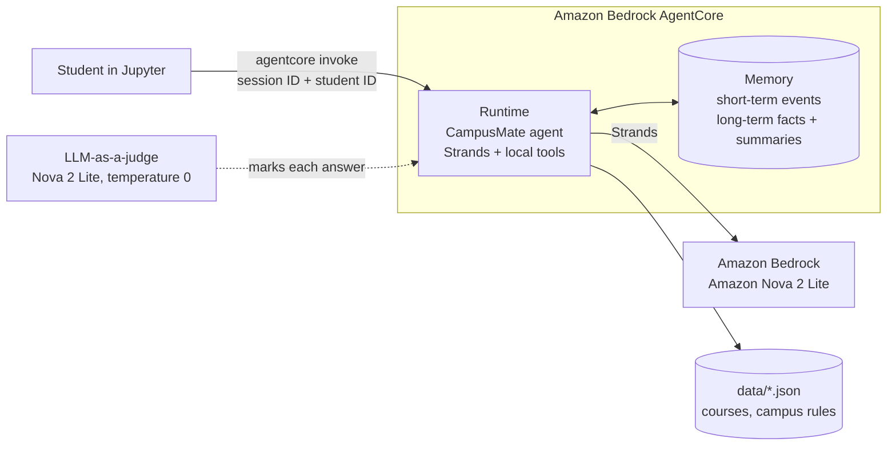

# Building Production-Ready AI Agents with Amazon Bedrock and AgentCore

> **Hands-on workshop for the AI-Driven DevOps (AIDD) program, School of Computer Science and Engineering, Jain (Deemed-to-be University), Bengaluru**

A two-day, hands-on workshop (9:00 AM - 3:30 PM each day) for 2nd and 3rd year B.Tech students.
You start with "what is a token?" and finish with an AI agent running on AWS, with memory and a report card, that you built yourself.

The running project is **CampusMate**, an AI assistant for students of the School of CSE. It answers questions about courses and campus rules,
remembers each student, and gets graded by a second model (LLM-as-a-judge).

> All student, course, policy and event data in this repository is **fictional** and labelled as such. Nothing here is a real university rule.

---

## What you will be able to do (learning objectives)

1. **Explain what an AI agent is**: an LLM (large language model) plus code that lets it call **tools**, with short-term and long-term **memory**.
2. **Build an agent locally** with Strands Agents and Amazon Bedrock, testing small pieces in Jupyter before running the whole thing.
3. **Give it memory**: AgentCore Memory for cross-session recall (short-term events, long-term facts).
4. **Grade it**: LLM-as-a-judge, a second model that marks each answer against the correct facts.
5. **Deploy it**: the same agent, with memory, on AgentCore Runtime, invoked from code.

## Architecture



## Learning path

| Day | Time | Notebook | You build | CampusMate |
|---|---|---|---|---|
| 1 | 9:00 | [01 GenAI foundations](notebooks/01-genai-foundations.ipynb) | Hallucination and statelessness demos | v0 |
| 1 | 9:45 | [02 AWS essentials](notebooks/02-aws-essentials.ipynb) | Identity, region, setup check; then a look at Amazon Bedrock | v0 |
| 1 | 10:15 | [03 Your first Strands agent](notebooks/03-first-strands-agent.ipynb) | A 4-line agent, then personality, memory of the chat, model choice, cost, a first tool | v0 |
| 1 | 11:15 | [04 Strands agents and tools](notebooks/04-strands-agents-and-tools.ipynb) | `get_course_info`, `get_campus_policy` | v1 local agent |
| 1 | 1:15 | [05 AgentCore Memory](notebooks/05-agentcore-memory.ipynb) | Create a Memory; a new conversation remembers semester and interests | v2 |
| 2 | 9:00 | [06 LLM-as-a-judge](notebooks/06-llm-as-a-judge.ipynb) | A judge model grades CampusMate against the campus data | v3 |
| 2 | 10:00 | [07 Deploy to AgentCore Runtime](notebooks/07-deploy-to-agentcore-runtime.ipynb) | Tools + memory deployed with `agentcore deploy`, invoked, then cleaned up | v4 |

The minute-by-minute run-of-show for the instructor is in [scripts/README.md](scripts/README.md).

## How the labs are built

Each lab builds on the one before. In notebooks 03-04 you write CampusMate in Python with Strands, in 05 you give it AgentCore Memory, in 06 you grade it with an LLM judge, and in 07 you deploy **that same agent** to AgentCore Runtime with the official **AgentCore CLI** (`agentcore create`, `add memory`, `deploy`, `invoke`).

## Quick start

Do the [SETUP.md](SETUP.md) pre-work **before Day 1** (about 30 minutes). Then:

```bash
source .venv/bin/activate              # Windows: .venv\Scripts\activate
python scripts/check_setup.py          # every line should say PASS
jupyter notebook notebooks/            # start with 01
```

README.md               you are here
SETUP.md                pre-work for macOS and Windows (Python, AWS CLI, Node.js, AgentCore CLI, uv), troubleshooting
requirements.txt        pinned, tested versions (Python 3.10+; tested on 3.12)
data/                   fictional courses, campus policies, students, events
notebooks/              the student labs 01-07
scripts/                instructor live demos for notebooks 01-04, and check_setup.py
```

## How much does it cost?

**Estimate: about US$1.50 (roughly Rs. 125) per student for the two days** with Amazon Nova 2 Lite. This assumes about 150 agent questions per student and cleanup at the end.

Where it comes from (us-east-1 prices from the AWS Price List API, 8 November 2026):

| Item | Price | Typical use per student | Approx. |
|---|---|---|---|
| Amazon Nova 2 Lite (`us.` profile) | $0.33 / 1M input, $2.75 / 1M output tokens | ~600K in, ~60K out | $0.40 |
| AgentCore Memory long-term retrieval | $0.0005 per record retrieved | ~1,000 records | $0.50 |
| AgentCore Runtime | $0.0895/vCPU-hour (active CPU only) + $0.00945/GB-hour | ~150 short sessions | $0.30 |
| S3, CloudWatch Logs | fractions of a cent | | < $0.10 |

**How to verify it:** in the AWS Billing console, activate the cost allocation tags `project` and `student` (Billing → Cost allocation tags; they show up
about 24 hours after activation). Then in **Cost Explorer**, filter by tag `project = campusmate-workshop`, group by **Service** (Amazon Bedrock,
Amazon Bedrock AgentCore) or by tag `student`. Model usage through inference profiles may show under the service name rather than the tag; group by
**Usage type** to see input/output tokens. Cost Explorer data lags by up to 24 hours.

**Always run the last cell of `notebooks/07-deploy-to-agentcore-runtime.ipynb` at the end** (it deletes your Runtime and Memory). Idle Memory and Runtime cost little, but stored data and logs keep accruing.

## Skills you leave with

- Building agents with Strands Agents on Amazon Bedrock: system prompts, model choice, token accounting and tool use.
- Writing tool-using agents in Python with Strands Agents, and testing them in small pieces.
- Deploying an agent to a serverless runtime with the AgentCore CLI, and calling it from code.
- Designing agent memory (short-term vs long-term, semantic vs summary) and handling asynchronous extraction.
- Measuring quality with an LLM-as-a-judge and a small answer key.
- Cleaning up cloud resources and reasoning about cost: a habit every employer notices.

## Credits

Adapted from the structure and style of the open-source *strands-agents-workshop* (notebooks alternate short explanations with code and end with
"Your turn"; scripts are short live-coding demos). Rewritten for Amazon Bedrock AgentCore as of November 2026.
